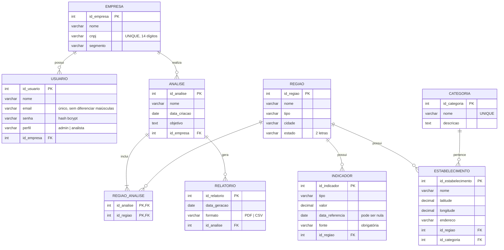

# Banco de dados do PontoZero

PostgreSQL 16. Tudo é criado pelos scripts de [`db/init`](../db/init), que o container executa em ordem na primeira vez que sobe com o volume vazio.

| Script | O que faz |
|---|---|
| `01_schema.sql` | As 9 tabelas do DER, com chaves e restrições |
| `02_indices_e_regras.sql` | Índices e triggers |
| `03_views_e_funcoes.sql` | Views e a função da análise de demanda x oferta |
| `04_carga_dados.sql` | Bairros, indicadores, segmentos, estabelecimentos e a conta de demonstração |
| `05_usuario_da_aplicacao.sh` | Usuário `pontozero_app` com permissões mínimas, usado pela API |

## Modelo

As tabelas e colunas são as do DER da equipe. O que foi acrescentado são regras de integridade, sem mudar o modelo.



### Cardinalidades e o que cada uma vira no SQL

| Relacionamento | DER | No banco |
|---|---|---|
| EMPRESA possui USUARIO | (0,n) : (1,1) | `usuario.id_empresa NOT NULL`, `ON DELETE RESTRICT` |
| EMPRESA realiza ANALISE | (0,n) : (1,1) | `analise.id_empresa NOT NULL`, `ON DELETE RESTRICT` |
| ANALISE inclui REGIAO | (1,n) : (0,n) | tabela associativa `regiao_analise` com chave primária composta; a API exige ao menos uma região ao salvar |
| ANALISE gera RELATORIO | (0,n) : (1,1) | `relatorio.id_analise NOT NULL`, `ON DELETE CASCADE` |
| REGIAO possui INDICADOR | (0,n) : (1,1) | `indicador.id_regiao NOT NULL`, `ON DELETE CASCADE` |
| REGIAO possui ESTABELECIMENTO | (0,n) : (1,1) | `estabelecimento.id_regiao NOT NULL` |
| ESTABELECIMENTO pertence a CATEGORIA | (1,1) : (0,n) | `estabelecimento.id_categoria NOT NULL`, `ON DELETE RESTRICT` |

### Regras de integridade

| Regra | Onde |
|---|---|
| Chaves primárias com `INT GENERATED BY DEFAULT AS IDENTITY` (forma moderna do SERIAL) | todas as tabelas |
| E-mail único sem diferenciar maiúsculas | índice único em `lower(email)` |
| E-mail sempre gravado em minúsculas | trigger `trg_usuario_email` |
| Senha nunca em texto puro: só aceita hash bcrypt | `CHECK (senha LIKE '$2%' AND length(senha) >= 59)` |
| Perfil só `admin` ou `analista` | `CHECK` |
| CNPJ com exatamente 14 dígitos e único | `CHECK` + `UNIQUE` |
| Estado com 2 letras maiúsculas | `CHECK (estado ~ '^[A-Z]{2}$')` |
| Latitude e longitude dentro dos limites | `CHECK BETWEEN` |
| Indicador sempre com fonte (HU-007) | `fonte NOT NULL` + `CHECK` de texto não vazio |
| Um valor por região, tipo e data | `UNIQUE NULLS NOT DISTINCT (id_regiao, tipo, data_referencia)` |
| Análise não pode ter data no futuro | trigger `trg_analise_data` |
| Formato do relatório só PDF ou CSV | `CHECK` |

## Views

| View | Para que serve |
|---|---|
| `vw_catalogo_indicador` | Rótulo, unidade e ordem de cada tipo de indicador |
| `vw_indicador_atual` | Valor mais recente de cada indicador por região (`DISTINCT ON`) |
| `vw_indicador_completo` | Indicadores guardados + densidade calculada (população ÷ área), sem armazenar dado derivado |
| `vw_oferta_regiao` | Registros observados por região e segmento; zero técnico não comprova ausência de estabelecimentos |
| `vw_referencia_categoria` | Média do Recife: estabelecimentos por 10 mil habitantes em cada segmento |
| `vw_resumo_analise` | Análises com quantidade de regiões e de relatórios |

## Função da análise (HU-009)

`fn_analise_demanda_oferta(id_categoria, regioes[], min_esperado = 2, cobertura_max = 0.5)`

```
referência proporcional = registros do segmento por 10 mil habitantes no Recife × população da região ÷ 10 mil
relação                 = registros observados ÷ referência proporcional
oferta observada baixa quando a referência proporcional ≥ 2 e a relação ≤ 50%
não classificada quando falta população ou o segmento não tem base
```

A função compara a base observada com a referência municipal. Ela não mede demanda e um resultado zero não comprova ausência de estabelecimentos, pois a cobertura do OpenStreetMap é parcial.

```sql
SELECT regiao, populacao, encontrados, esperado, classificacao, motivo
FROM fn_analise_demanda_oferta(
    (SELECT id_categoria FROM categoria WHERE nome = 'Farmácia'),
    ARRAY(SELECT id_regiao FROM regiao WHERE nome IN ('Casa Amarela', 'Água Fria', 'Boa Viagem'))
);
```

## Segurança

A API conecta como `pontozero_app`, que só lê as tabelas de referência e só escreve em `empresa`, `usuario`, `analise`, `regiao_analise` e `relatorio`. Se alguém tentar `INSERT INTO regiao` com esse usuário, o banco responde `permission denied`.

## Consultas para treinar

Abra o banco no pgAdmin ou DBeaver (`localhost:55432`, banco `pontozero`, usuário `pontozero`, senha `pontozero_admin`) ou rode `docker compose exec db psql -U pontozero -d pontozero`.

```sql
-- 1. Os 5 bairros mais populosos
SELECT r.nome, i.valor AS populacao
FROM regiao r JOIN indicador i ON i.id_regiao = r.id_regiao AND i.tipo = 'populacao'
ORDER BY i.valor DESC LIMIT 5;

-- 2. Quantos estabelecimentos de cada segmento existem no mapa
SELECT c.nome, count(e.id_estabelecimento) AS total
FROM categoria c LEFT JOIN estabelecimento e ON e.id_categoria = c.id_categoria
GROUP BY c.nome ORDER BY total DESC;

-- 3. Bairros sem nenhuma farmácia na base (LEFT JOIN + IS NULL)
SELECT r.nome
FROM regiao r
LEFT JOIN estabelecimento e
       ON e.id_regiao = r.id_regiao
      AND e.id_categoria = (SELECT id_categoria FROM categoria WHERE nome = 'Farmácia')
WHERE e.id_estabelecimento IS NULL
ORDER BY r.nome;

-- 4. Renda média de 2010 e população de 2022 lado a lado (duas fontes, duas datas)
SELECT r.nome,
       max(i.valor) FILTER (WHERE i.tipo = 'populacao')              AS populacao_2022,
       max(i.valor) FILTER (WHERE i.tipo = 'renda_media_domiciliar') AS renda_2010
FROM regiao r JOIN indicador i ON i.id_regiao = r.id_regiao
GROUP BY r.nome ORDER BY renda_2010 DESC LIMIT 10;

-- 5. Análises de cada empresa com as regiões incluídas (N:N)
SELECT e.nome AS empresa, a.nome AS analise, string_agg(r.nome, ', ' ORDER BY r.nome) AS regioes
FROM analise a
JOIN empresa e         ON e.id_empresa = a.id_empresa
JOIN regiao_analise ra ON ra.id_analise = a.id_analise
JOIN regiao r          ON r.id_regiao = ra.id_regiao
GROUP BY e.nome, a.nome;

-- 6. Testar as regras: as duas linhas abaixo devem falhar
INSERT INTO usuario (nome, email, senha, id_empresa) VALUES ('X', 'x@x.com', '12345678', 1);  -- senha sem hash
INSERT INTO regiao (nome, tipo, cidade, estado) VALUES ('X', 'Bairro', 'Recife', 'pe');     -- estado minúsculo
```

## Dados

| Tabela | Linhas | Origem |
|---|---|---|
| `regiao` | 94 | bairros oficiais da Prefeitura do Recife |
| `indicador` | 470 | IBGE (Censo 2022 e 2010) e área da Prefeitura |
| `categoria` | 6 | segmentos do piloto |
| `estabelecimento` | 532 | OpenStreetMap |
| `empresa`, `usuario`, `analise`, `regiao_analise`, `relatorio` | 1, 1, 1, 3, 1 | conta de demonstração |

A fonte e a data da camada de oferta ficam registradas no próprio banco, no comentário da tabela: `SELECT obj_description('estabelecimento'::regclass);`
